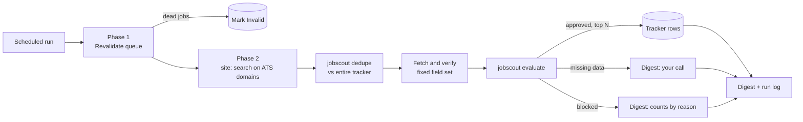

<div align="center">

# ats-job-scout

**An AI job scout that reads the job boards so you don't have to.**
Once a week it finds the handful of postings actually worth your time, checks they are still open,
writes them to your tracker, and sends you a digest you can read on your phone.

[](https://github.com/GITHUB_USER/ats-job-scout/actions/workflows/tests.yml)


</div>

---

A large remote job API will happily hand you **97,000 postings**. You want **five**.

Most job alert tools solve the wrong half of that problem. They find more. This project
is about finding *less*: the few roles that match your level, your region, your pay floor
and the way you want to work, with every claim checked against the posting itself.

It is a playbook for an AI agent (Claude, with web search, web fetch and Notion), plus a
small, fully tested Python package that makes the parts that should be deterministic,
actually deterministic.

> Built by a QA engineer and run every week against her own job search since August 2026.
> Every rule in here exists because a real posting slipped through, or a good one got
> dropped. The [lessons learned](docs/lessons-learned.md) are half the value.

## What you get every week

```text
Top this run (1)
  Northwind Labs, Staff Quality Engineer: USD 120-135k published, EOR.
  Async: "We are async-first and write everything down". Playwright + TS, LLM eval.
  https://job-boards.greenhouse.io/northwindlabs/jobs/4000001

Missing data, your call (1)
  Fabrikam AI, Principal QA Engineer. LATAM eligible.
  Missing: async (5h US overlap, no flexibility mentioned) and pay.
  Company: https://job-boards.greenhouse.io/fabrikam/jobs/5000002

Blocked (14)
  region: 6, not fully remote: 3, level: 2, consultancy without pay: 2, pay below floor: 1

Revalidation
  Marked Invalid: Litware, Senior QA (404)
```

*Fictional example. Full version in [examples/sample-digest.md](examples/sample-digest.md).*

## Why it is different

**It revalidates before it searches.** Postings die fast. One sweep found 15 of 26 queued
jobs already closed, some under a week old. Every run first re-checks your "To Apply"
queue and marks dead postings Invalid, with strict safeguards: it never touches anything
you already acted on, and never marks a job dead on a timeout or a hunch.

**"Missing" is not "blocked".** A posting that is hybrid, region locked or underpaid is
blocked. A posting that simply *doesn't mention* async work or salary is not wrong, it is
unknown. Those go to their own digest section for you to decide, instead of silently
disappearing. This one rule recovered the best postings the search had been losing.

**Every claim is verified on the posting.** The agent fetches each job and extracts a
fixed set of fields (eligibility, remote type, literal async quotes, salary, mandatory
stack). "Remote First" in a title counts for nothing; only the body does.

**It prefers the company's link over the aggregator's.** Aggregators are often stale,
masked, or rewrite pay and eligibility. The scout finds the original on the company's
ATS and gives you both.

**It never shows you the same job twice.** Dedupe runs against your whole tracker,
including rejected and dead rows, by normalized URL *and* by company plus role, and also
catches duplicates within the same run.

**It gets better every run.** Each run logs what it learned about sources, queries and
rules, and the next run reads that log first. Queries that stop finding new jobs get
retired; ones that work get promoted.

**No scraping, no API keys, no servers.** It uses the agent's own search and fetch tools,
respects `robots.txt`, and the Python helpers make zero network calls. It runs as a
scheduled task in the cloud while your laptop is closed.

**It does not apply for you.** On purpose. It decides what deserves your attention; you
decide what to do with it.

## How it works



The agent does what only an agent can do: search, read messy job pages, find the
original posting, estimate pay from a sibling req. The `jobscout` package does what code
should do: normalize, dedupe, apply rules, rank, so the same posting gets the same verdict
every time.

## Quick start

**You need:** an agent that can run on a schedule with web search, web fetch and a
Notion connector (for example a Claude scheduled task), and a Notion database.

1. **Fork or clone** this repo.
2. **Write your profile.** Copy the examples and make them yours:
   ```bash
   cp config/profile.example.yaml config/profile.yaml
   cp config/queries.example.yaml config/queries.yaml
   ```
   Roles, accepted levels, regions in order of preference, pay floors, hard blockers and
   the fit signals that should rank a posting higher. Both files are git-ignored.
3. **Set up the tracker.** Follow [docs/notion-setup.md](docs/notion-setup.md): a few
   properties and two views.
4. **Create the scheduled task.** Paste [prompts/collector.md](prompts/collector.md) into
   it, fill in the placeholders, and paste your two config files where marked.
   Weekly works well; more often mostly finds the same jobs.
5. **Test your rules locally** (optional but recommended):
   ```bash
   pip install -r requirements-dev.txt
   pytest
   ```

## The `jobscout` helpers

Two commands, JSON in and JSON out, so the agent can call them mid-run.

```bash
# Drop candidates already in the tracker (any status), or repeated within the batch
python -m jobscout dedupe --tracker tracker.json --candidates found.json

# Apply your rules, rank, cap, and print a digest
python -m jobscout evaluate --profile config/profile.yaml --jobs verified.json --markdown
```

What `evaluate` decides:

| Verdict | When | What happens |
|---|---|---|
| `approved` | Passes every rule | Ranked; top `max_per_run` become tracker rows |
| `missing_data` | Only absent data: no async signal, required overlap without flexibility, no pay anywhere | Digest section for you; never auto added |
| `blocked` | Evidence against: closed, not fully remote, wrong region, level, blocker flag, blocker tech listed as *mandatory*, pay below floor, consultancy without pay | Counted by reason |

Pay handling compares the top of the published range, supports USD floors per month, year
or hour, a separate floor for a local currency and contract type (for example BRL on CLT),
and FX conversion for everything else. The rules are covered by 40+ tests, including the
edge cases that bit in production. See [tests/test_rules.py](tests/test_rules.py).

## Not a QA engineer?

The example profile is for QA and test automation roles because that is where it was
born, but nothing in the code is QA specific. Change `roles`, `blockers`, `fit_signals`
and the queries, and it works for backend engineers, designers, data people, anyone whose
jobs live on ATS pages.

## Lessons learned, the short version

- **Agent sandboxes usually have no open internet**, so a scraper won't run. The scout is
  a playbook for the agent's own search and fetch tools instead.
- **Generic remote boards ignore keyword filters.** `site:` searches on Greenhouse, Lever,
  Ashby, Workable and friends work far better.
- **Greenhouse has a public jobs API** that is more reliable than its board pages. Ashby
  and Workday are JavaScript only; LinkedIn is login walled.
- **Fixed queries saturate** within a few weeks. Let the run log keep editing them.
- **A false block costs the whole posting.** Blocker tech only counts when it is mandatory.

All 13, with the evidence behind each: [docs/lessons-learned.md](docs/lessons-learned.md).

## Repository layout

```text
prompts/collector.md          The scheduled task prompt, with placeholders
config/*.example.yaml         Example profile and search plan (copy, then edit)
jobscout/                     Offline helpers: normalize, dedupe, rules, CLI
tests/                        pytest suite, run in CI on every push
docs/lessons-learned.md       What broke, and what replaced it
docs/notion-setup.md          Tracker properties and views
examples/sample-digest.md     What a run sends you
```

## FAQ

**Will it apply to jobs for me?** No, by design. Applications deserve a human, and
several companies now state they use AI to flag inconsistent applications.

**Does it scrape job boards?** No. It uses the agent's own web search and fetch tools, one
page at a time, and skips sources whose `robots.txt` disallows automated collection.

**Do I need Notion?** The prompt assumes it, but any tracker your agent can read and write
works. The Python helpers only need a JSON export.

**Does it work with other agents?** The prompt is plain English and the helpers are plain
Python. Anything with search, fetch and a scheduler should cope; it has been run with
Claude.

**What about prompt injection in job postings?** The prompt tells the agent to report any
text aimed at AI systems and never follow it.

## Contributing

Issues and pull requests are welcome, especially:

- ATS compatibility findings (what renders, what has a public API)
- sources that filter well for a role or region
- rule edge cases, ideally with a failing test

Please keep personal data (yours or anyone's) out of examples and tests.

## About

Made by [Camila Puchta](https://camipuchta.dev), a QA engineer moving into software
engineering. If it saves you a few hours of scrolling, a star helps other people find it.

MIT licensed. See [LICENSE](LICENSE).
